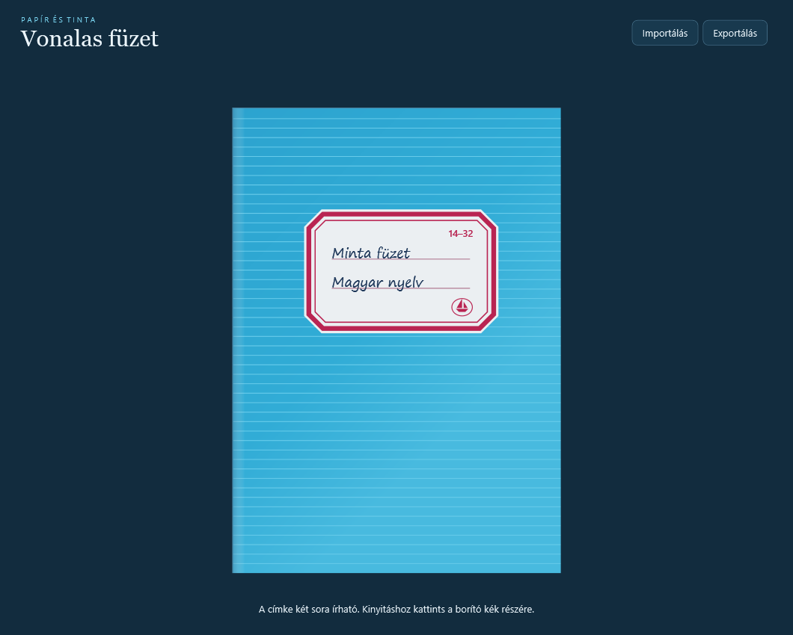
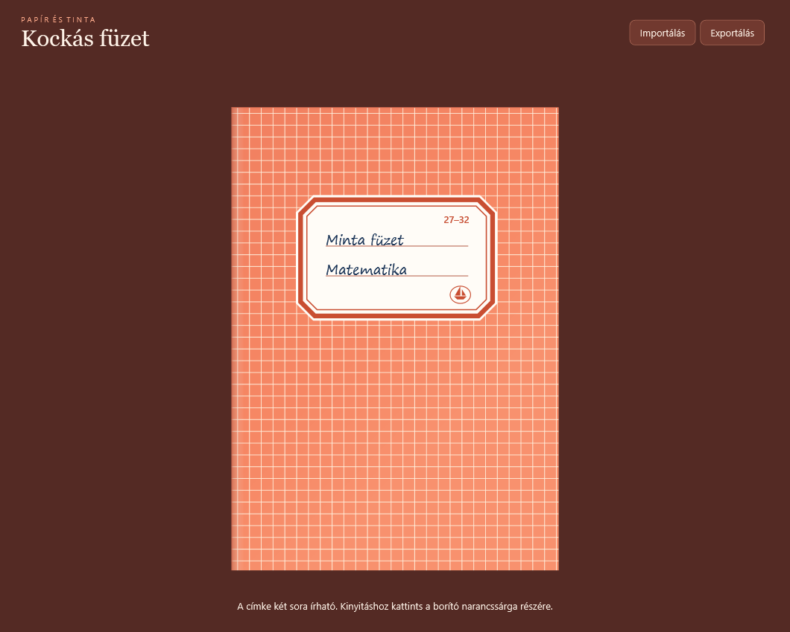
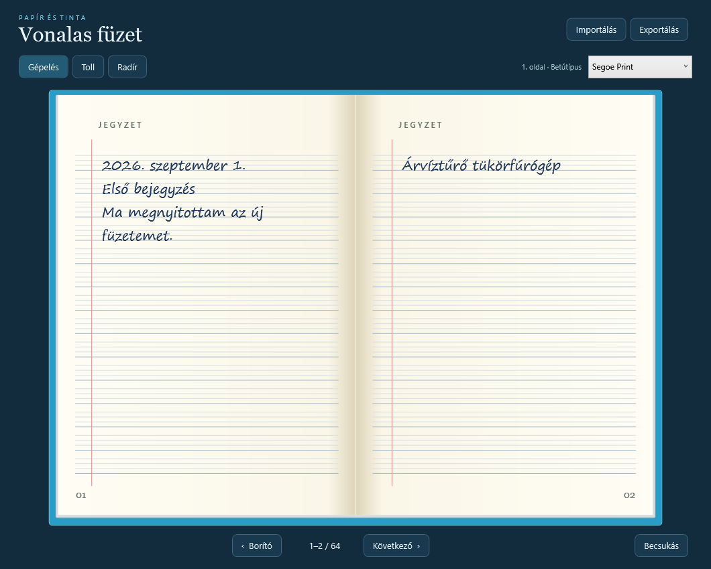
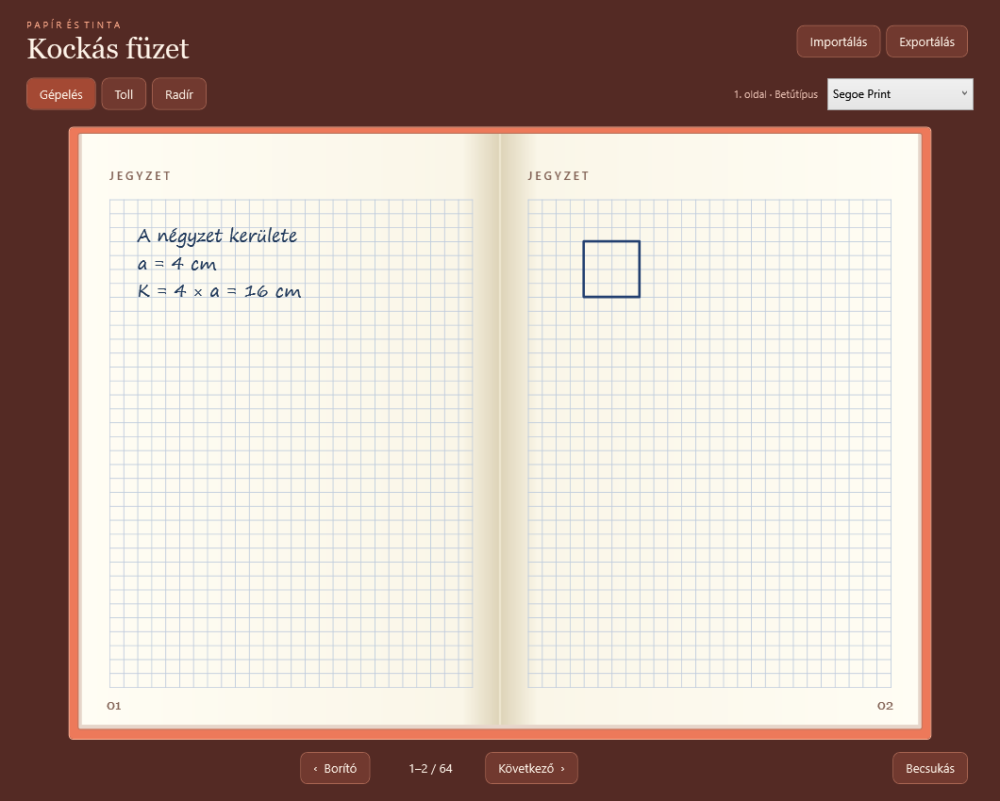

# Papír és tinta

Két magyar nyelvű Windows-alkalmazás, amelyek egy nyitott iskolai füzetet idéznek. A **Vonalas füzet** segédvonalas, margózott lapokat kapott, a **Kockás füzet** pedig négyzetrácsos oldalakat.

| Vonalas füzet | Kockás füzet |
| --- | --- |
|  |  |
|  |  |

## Letöltés

A [kiadásoknál](../../releases/latest) található a `VonalasFuzet.exe` és a `KockasFuzet.exe`. Windows 10 vagy 11 alatt a választott fájl dupla kattintással elindítható. A két program külön használható, telepítő és mellékelt fájlok nélkül.

## Használat

- A füzet csukva indul. A címke két sorát átírhatod. A borító színes részére kattintva a füzet az utoljára használt oldalpárnál nyílik ki.
- A külső lapszélekre kattintva animációval lapozhatsz. Az első oldalpár bal széle visszavisz a borítóra. Alul külön lapozó és **Becsukás** gomb is van.
- **Gépelés** módban a szöveg a lap vonalaihoz igazodik, és oldalanként választhatsz betűtípust. A **Toll** eszközzel egérrel vagy digitális tollal írhatsz, a **Radír** vonásonként töröl.
- A programok automatikusan, egymástól elkülönítve mentik a jegyzeteket, a címkét és az utolsó oldalt. Az **Exportálás** egyetlen fájlba teszi a teljes füzetet. A vonalas változat `.fuzet`, a kockás `.kockasfuzet` fájlt használ. Importáláskor a betöltött füzet megerősítés után a jelenlegi helyére kerül.

## Fordítás forrásból

A [vonalas](Fuzet.cs) és a [kockás](KockasFuzet.cs) változat külön C# forrásfájlból készül. A felület WPF-alapú, a futtatható fájlok a saját forrásukat is tartalmazzák.

A fordításhoz Windows, a Windows részeként elérhető .NET Framework 4.x és egy .NET 8 SDK szükséges. PowerShellben a tároló mappájából futtasd:

```powershell
.\build.ps1
```

Mindkét EXE a `dist` mappába kerül. Az eredeti kiadás a .NET SDK 8.0.427-es fordítójával készült.

A borítók vizuális mintái a Fűzfői Papírmanufaktúra [Harmónia 14–32 vonalas](https://fuzet.arukereso.hu/fuzfoi-papirmanufaktura/harmonia-a-5-1-osztalyos-32-lapos-vonalas-fuzet-1432000urg-p982535742/) és [Harmónia 27–32 kockás](https://www.jatekshop.eu/harmonia-kockas-fuzet-a5-27-32-22506.html/hun) füzetei.

## Licenc

Mindkét alkalmazás az [MIT licenc](LICENSE) alatt érhető el.
